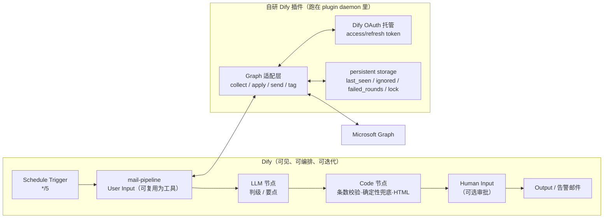

# 方案 A 详细设计（讨论稿）：把 Email Manager v3.0.0 搬成全 Dify 工作流

> 前置阅读：[DIFY_MIGRATION_ADVICE.md](DIFY_MIGRATION_ADVICE.md)（总体三方案对比、Dify 硬限制、验收方法）
> 本文只讨论方案 A（无本地常驻进程，邮件读写全部通过 Dify 插件完成）。
> 对照源码：`Email_manager_beta` v3.0.0（`core/graph.py` 852 行、`core/classifier.py` 583 行、`core/ai.py` 531 行、`core/mailmeta.py` 139 行、`gui/watcher.py` 566 行）
> 对照 Dify：自部署 1.11–1.19 官方文档；`langgenius/outlook` 1.0.1；插件开发文档（OAuth、KV 存储、打包）
> 标注「待实测」的条目必须在 P0 决策门里用你自己的 Dify 实例验证后再定稿。

---

## 0. 结论先行

1. **方案 A 可行，但不是"零代码"**。官方 Outlook 插件补不齐三样东西：**写 categories**、**跨运行状态**、**按 categories 读取（出报告用）**。所以 A 方案必然包含 **1 个自研 Dify 插件**。
   > 已核对官方插件源码（`langgenius/dify-official-plugins` → `tools/outlook/tools/list_messages.py`、`get_message.py`）：List Messages 的 `$select` 只有 id/subject/sender/收件人/receivedDateTime/bodyPreview/isRead/hasAttachments/importance/conversationId/webLink，**没有 categories、也没有 flag 状态**；Get Message 也不返回 categories。`list_messages` 新支持 `include_body=true`，会把**未截断的 HTML 正文**一起返回。结论：官方插件可以发信、看信，但**做不了原程序的"按标签幂等/按标签出报告"**。
2. 自研插件的"厚度"决定 A 的形态，有两个子方案：
   - **A1+「薄插件 + 厚工作流」**：官方插件负责取正文/发信/旗标；自研插件补 `set_categories`、`list_headers`（带 categories 的头部列表）、KV 状态。分类批处理、校验、兜底规则、状态推进都做成 Dify 节点，最像"工作流"。
   - **A2「厚插件 + 薄工作流」**（生产向推荐，源码核对后更推荐）：自研一个邮件适配插件，把 `graph.py` 的读信/取正文/发信/写分类 + `mailmeta` 的合并规则 + `watcher` 的状态推进全部搬进去；Dify 只保留 Schedule Trigger、LLM 判定、Code 校验/兜底、审批、告警。工作流约 12 个节点，保真度最高，也不再有"两个插件、两套 OAuth"的运维负担。
3. **认证是 A 方案的第一道门**：优先用 Dify 插件 OAuth（authorization code + refresh token 由 Dify 托管，自动处理 token 轮换）。它比原程序的设备码更省事，但要求：自建 Entra 应用、HTTPS 回调、Dify 的 `CONSOLE_WEB_URL` 与回调域名一致。若这些走不通，再在插件内部复刻设备码（原 `graph.py:275-432` 的逻辑），代价是插件多 150 行、token 自管。
4. **工作量**：A1+ 约 3–4 天；A2 约 3–4 天（**fork 官方插件**实现，含 OAuth 调试、Golden Set 对照；从零写为 4–6 天）。建议先用**半天 P0 决策门**验证官方插件与 OAuth，再决定插件厚度。
   > 实现策略见 3.2：官方插件是 Apache-2.0 开源，直接 fork 它比从零写便宜得多——OAuth、token 刷新、Graph 底座、每用户/多邮箱授权模式都是现成的，我们只需加"读/写 categories + 状态 KV + 采集工具"。

---

## 1. A 方案的边界：Dify 管什么、插件管什么



切分原则（和方案 B 的边界一致，只是把 Python 进程换成 Dify 插件）：

| 放进 Dify（节点/变量/日志） | 放进插件（代码/状态/Graph） |
|---|---|
| 定时、编排、重试分支、告警 | Graph 认证与调用 |
| prompt、模型、结构化输出 | categories 读取/合并/写回 |
| 条数校验、确定性兜底（读起来直观） | 基线推进、ignored、失败轮次、锁 |
| 报告 HTML、审批表单 | 报告发送、`Sum` 标签 |
| 人要看/要改的一切 | 需要原子性/逐封对齐/递归的一切 |

> 注意：如果插件把"采集 + 写回 + 状态"都做了，工作流里就只剩 LLM 与校验——这仍然是 Dify 工作流，只是"厚适配层"。不要为了"看起来节点多"把容易写错的逻辑硬塞进节点。

---

## 2. 认证设计（A 方案的第一道门）

### 2.1 首选：Dify 工具插件 OAuth（authorization code + Dify 托管刷新）

自研插件在 provider manifest 里声明 `oauth_schema`，实现三个方法，Dify 负责：
- 生成授权 URL（`_oauth_get_authorization_url`）；
- 用回调 code 换 token（`_oauth_get_credentials`）；
- 过期自动刷新（`_oauth_refresh_credentials`），**并把 Microsoft 轮换后的新 refresh_token 存回**（这正是原程序要自己处理、`core/graph.py:401-415` 的痛点）。

| 项 | 值/做法 |
|---|---|
| Entra 应用 | 自建（不能再用原程序 `FALLBACK_CLIENTS` 的微软公开 client，`graph.py:54-58` 只适合自用脚本；插件要自己的 Web 平台应用） |
| 平台/回调 | Web 平台；Dify 给出的回调形如 `https://{CONSOLE_WEB_URL}/console/api/oauth/plugin/{plugin-id}/{provider}/{tool}/callback`，逐个注册到 Entra 的 Redirect URI |
| 委托权限 | `offline_access`、`User.Read`、`Mail.ReadWrite`、`Mail.Send`（只读的 `Mail.Read` 不够写分类） |
| 客户端密钥 | Entra `Certificates & secrets` 的 **Value**；作为插件 OAuth Client 的 secret 存进 Dify（Dify 加密保存） |
| SDK/版本 | `dify_plugin>=0.5.0`；`minimum_dify_version: 1.7.1`（OAuth 的最低要求） |
| 多插件 | 若同时用官方插件和自研插件，各自需要一个授权；同一个 Entra 应用可挂多个 Redirect URI，client secret 复用 |

**关键校验点（P0）**：Dify 所在地址若只是 `http://localhost` 或局域网 IP，Microsoft 可能拒绝该 Redirect URI（Web 平台通常要求 HTTPS，localhost 例外情况需实测）。生产建议给 Dify 配一个 HTTPS 域名（Cloudflare Tunnel / 反代都行），否则退回 2.2。

### 2.2 备选：插件内实现设备码（复刻原程序）

- 在插件里加一个 `sign_in` 工具：调用 `/devicecode` 拿 `user_code`，返回给工作流（Output 或发邮件）；
- 插件用 `session.storage` 自己存 `refresh_token/client_id/expires_at`（原 `graph.py:401-415` 的逻辑可直接搬）；
- 优点：**不需要回调 URI/HTTPS/Entra Web 平台**，最接近原程序体验；
- 缺点：token 刷新/轮换/失效判定都要自己写（原 `graph.py:364-398` 的 `_DEAD_CREDENTIAL_ERRORS` 语义），插件复杂度 +150 行。
- 适用：Entra 应用注册被租户策略卡住、或 Dify 只能内网访问时。

### 2.3 明确不要做的

- ❌ 把 refresh token 放进 Dify 环境变量、用 HTTP 节点自己刷新：Dify 环境变量运行期只读，而 Microsoft 每次刷新都会轮换 refresh token → 第二次就失效（原程序因为落盘才有轮换能力）。
- ❌ 用 Service Principal（application 权限）：需要管理员同意，学生账号基本拿不到；也不符合"个人邮箱"场景。
- ❌ 在 LLM 上下文/Output 里出现 token：Dify 运行日志会记节点输入输出，等于泄露。

---

## 3. 自研插件规格

### 3.1 两种厚度

| | A1+ 薄插件（`email-state`） | A2 厚插件（`email-manager-graph`） |
|---|---|---|
| 工具 | `state_get` / `state_lock` / `state_unlock` / `state_set` / `set_categories` / `list_headers` | `collect_new` / `collect_recent` / `apply_verdicts` / `tag_sum` / `send_report` / `state_*` |
| Graph 调用 | 只读头部列表（`$select` 不含 body）+ 分类 PATCH | 全部（头部列表、按需正文、PATCH、sendMail） |
| 官方插件用途 | List Messages / Get Message / Send Message / Flag Email | 可以完全不用（或只用 Send Message） |
| 插件代码量 | ≈350–500 行 | ≈800–1000 行 |
| 工作流节点数 | 约 25–35（有 Iteration/Loop） | 约 12–15（读起来像流程说明书） |
| 受限点 | 30 项 object 数组、200KB 变量、500 步、无递归 | 基本不受节点限制（插件内部循环） |
| 适合 | 想保留"可视化工作流"、能接受偶发拆分降级 | 日常生产、追求原语义保真 |

> 建议默认 **A2**；如果目标是演示/学习 Dify 编排，选 **A1+**。两者可以共用同一套 Dify 工作流骨架（只是节点内调用不同工具），后续可以平滑切换。

**官方插件源码核对结论（影响选型，已确认，不必再猜）**

| 事实 | 出处 | 影响 |
|---|---|---|
| List Messages 的 `$select` 不含 `categories`、`flag` | `tools/outlook/tools/list_messages.py` | 工作流无法判断"已分类/被谁分类"；A1+ 必须自研 `list_headers` |
| Get Message 同样不返回 categories/flag | `tools/outlook/tools/get_message.py` | 出报告无法按级别筛选；只能靠外部记录或自研读取 |
| `list_messages` 支持 `include_body=true`（返回未截断 HTML） | 同上 | 可选：一次调用拿正文；但变量体积不可控，仍需截断；A1+ 可用 `get_message` 逐封取 |
| limit 1–100、按 receivedDateTime 倒序、支持 `$search` | 同上 | 分页/时间过滤需自己按需组合 |
| 官方插件有 OAuth（共享邮箱）/ Service Principal / 每用户登录三种授权，token 由 Dify 托管刷新 | `tools/outlook/tools/graph_client.py`、`user_auth.py` | 自研插件可以复用同一套 Dify OAuth 机制（`runtime.credentials["access_token"]` 由 Dify 注入并自动刷新） |

### 3.2 实现策略：fork 官方插件（推荐）

官方插件仓库 `langgenius/dify-official-plugins` 是 **Apache-2.0**（`LICENSE` 明确可修改分发，要求保留版权/许可声明并标注改动文件）。`tools/outlook/` 已经包含：

- `provider/outlook.yaml` + `provider/outlook.py`：OAuth / Service Principal / 每用户三种授权模式的完整声明与校验；
- `tools/graph_client.py`：Graph 底座（token 解析、云环境、错误描述、扁平输出字段）；
- `tools/user_auth.py`：每用户登录示例（**用 `session.storage` 存 token**，证明插件 KV 可用）；
- `tools/*.yaml`：工具声明范式；`list_messages.py`/`get_message.py`/`send_message.py`/`flag_message.py` 都可参考；
- `manifest.yaml`：`minimum_dify_version: 1.7.0`、`resource.permission.storage.size: 10MB` 的现成配置。

我们的做法（A2-fork）：

1. 复制 `tools/outlook/` 为 `email-manager/`，改 `manifest.yaml` 的 name/version/描述；
2. 在 `provider/outlook.yaml` 保留 OAuth（共享邮箱）模式（或按需保留三种），保留 `graph_client.py`；
3. **给 `list_messages` 的 `$select` 加 `categories`、`flag`**，输出里加 `categories[]`、`flag_status`（最小改动，约 20 行）；
4. 新增工具 `set_categories`（读-合并-PATCH，flags 同步）、`state_get/state_set/state_lock/state_unlock/state_advance`（用 `session.storage`）；
5. 新增工具 `collect_new`（组合"头部列表 + 跳过规则 + 按需正文 + 截断"），把原 `graph._collect` 的语义搬进来；
6. 打包 `dify plugin package ./email-manager`，本地安装。

收益：OAuth 链路、Graph 调用、输出变量声明全部复用，估计 **插件工作量从 3 天降到 1.5–2 天**，且升级 Dify 时随上游修 bug；若愿意提 PR，把 `set_categories` 推回官方插件，连 fork 都能少维护一份。

> 注意：Apache-2.0 分发要求保留 LICENSE 与版权声明，并在被修改的文件里注明"已改动"；不要用官方名称/图标冒充官方插件。

### 3.3 工具契约（A2 版本，A1+ 是子集）

所有业务失败**不抛异常**，统一返回：

```json
{"success": true, "transient": false, "error": "", "...数据字段": "..."}
```

理由：Dify 节点失败会中断流程，而原程序把"邮箱不可用"当正常情况（`core/graph.py:72-86`）；返回 `transient=true` 让工作流自己决定"不推进状态、下轮重试"。

| 工具 | 入参 | 出参 | 对应原实现 |
|---|---|---|---|
| `collect_new` | `last_seen`、`days`、`max_items`（默认 30）、`with_body` | `{success, transient, error, items:[{entryid,subject,sender_name,sender,received,web_link,categories,body}], newest_id, oldest_id}` | `graph.collect_new_mail` + `fill_body` + `message_info`（`core/graph.py:705-758`） |
| `collect_recent` | `days`、`letters`、`max_items` | `{items:[{entryid,level,subject,sender,body,received,web_link}]}` | `graph.read_recent`（`core/graph.py:761-781`） |
| `apply_verdicts` | `verdicts:[{entryid,level,deadline,urgent,is_school}]`、`dry_run` | `{ok, failed, skipped, transient, errors:[{entryid,error}]}` | `classifier.apply_verdicts` + `mailmeta.merge_categories` + `graph.write_categories`（`classifier.py:471-511`、`mailmeta.py:104-112`、`graph.py:826-844`） |
| `tag_sum` | `entryids[]` | `{ok, failed}` | `graph.write_categories(msg,[SUM_NAME])`（`watcher.py:380-404`、`:426`） |
| `send_report` | `to`、`subject`、`html` | `{success, transient, error}` | `graph.send_mail`（`graph.py:592-600`） |
| `state_get` | — | `{state, version}` | `watcher.load_state`（`watcher.py:49-63`） |
| `state_lock` | `owner`、`ttl_seconds` | `{acquired, lock_until, holder}` | 新增（替代 TaskRunner 串行） |
| `state_unlock` | `owner` | `{released}` | 新增 |
| `state_advance` | `oldest_entryid`、`newest_entryid`、`failed`、`ignored_ids[]` | `{last_seen, failed_rounds, gave_up}` | `watcher.advance_policy`（`watcher.py:106-128`）+ `_commit`（`:470-478`） |
| `state_report_mark` | `subject`、`at` | `{ok}` | 报告去重（`last_report_at`） |

要点：

- `collect_new` 内部完成：头部列表（`SELECT_HEADERS` 不含 body，`graph.py:61-63`）→ 跳过自家报告/`sum` 指令/已分类/ignored → 按 `last_seen` 截断 → 只对候选逐封取正文（可并发 5–10，插件内线程池）→ 归一化成统一字典。工作流拿到的是"已经筛干净的 ≤30 封"，这正是原 `_collect` 的语义（`graph.py:705-736`）。
- `apply_verdicts` 内部完成：非学校跳过（不写、不算失败）、`merge_categories` 只替换自己的标签、S+urgent 打旗标、单封失败不拖垮整批。**C1/C2/C5 三条契约都由这一层保证**。
- 插件是**配置无关**的：`school_domains`/`courses`/`faculty`/`urgent_days` 由工作流作为参数传入（值来自 Dify 环境变量），这样换学校/课程仍然只在 Dify UI 改，不用重打包插件。
- `state_*` 用 `self.session.storage`（workspace 级 KV，bytes）。**没有 CAS 原语** → 见 5.2 的锁协议与取舍。
- 插件 `resource.storage` 申报 10MB 足够（状态 JSON 只有几 KB；ignored 上限 1000 条约 30KB）。
- 打包安装：`dify plugin package ./email-manager-graph` → 控制台「安装插件 → 本地文件」。不需要上 Marketplace。

### 3.4 Graph 调用规则（原实现逐条搬）

| 规则 | 原实现 | 插件里怎么做 |
|---|---|---|
| 轮询只拉头 | `SELECT_HEADERS`（`graph.py:61-63`） | `$select` 同款，body 只对候选取 |
| 429/5xx 退避 | `_retry_delay` 读 `Retry-After`，GET 最多 3 次（`graph.py:196-248`） | 原样；**PATCH/sendMail 不自动重试**（非幂等） |
| 网络/限流归类 | `MailboxUnavailable`（`mailmeta.py:41-46`） | 返回 `transient=true`，不抛异常 |
| 凭据失效才重登 | `_DEAD_CREDENTIAL_ERRORS`（`graph.py:364-398`） | OAuth 托管模式下 Dify 会自动刷新；刷新失败 → `transient=false` + 提示重新授权 |
| 幂等 id | `Prefer: IdType="ImmutableId"`（`graph.py:228-230`） | 原样，监听基线依赖它 |
| 正文 HTML→文本 | `_strip_html`（`graph.py:436-445`） | 原样（官方插件的 body 可能是 HTML，A1+ 也要在 Code 里补这一步） |

---

## 4. 应用与工作流设计

### 4.1 应用拆分（4 个 App）

| App | 起始节点 | 职责 | 被谁调用 |
|---|---|---|---|
| `mail-pipeline` | User Input | 一轮完整处理：锁 → 采集 → LLM → 校验/兜底 →（审批）→ 写回 → 推进状态 | `email-watch`、`email-toolbox` 以工具方式调用 |
| `email-watch` | Schedule Trigger | 定时调 `mail-pipeline(mode=watch)`；处理 `sum` 指令；瞬时故障退避；真错误告警/暂停 | 定时自动 |
| `email-toolbox` | User Input | 手动 `classify`（dry-run/force）、`sum`、`check`；发布为 WebApp | 人工点击 |
| `sum-report` | User Input | 读已分级邮件 → 一句话要点 → HTML → 发送并打 `Sum` 标签；被 `mail-pipeline` 当工具调用 | `email-watch`、`email-toolbox` |

为什么这样拆：

- Trigger 工作流不能发布为 WebApp/API（Dify 限制），所以"手动按钮"必须是 User Input 工作流；
- 判级/写回逻辑只写一份，放在 `mail-pipeline`，另外两个应用通过 Tool 节点调用（`WORKFLOW_CALL_MAX_DEPTH=5`，够用）；
- `sum-report` 单独拆开，避免定时工作流为了一个指令邮件背上一整套报告节点。

### 4.2 `mail-pipeline`（A2 版节点表）

| # | 节点 | 关键配置 | 失败分支 |
|---|---|---|---|
| 1 | User Input | `mode`(watch/manual)、`days`(默认 7)、`dry_run`、`force`、`approve`(bool) | — |
| 2 | Tool `state_get` | 读状态 | 默认值 `{}` + 告警 |
| 3 | Tool `state_lock` | owner=`{{sys.workflow_run_id}}`，TTL=600s | 未抢到 → Output `skipped` |
| 4 | Code：解析状态 | 提取 `last_seen`/`ignored`/`failed_rounds`；`paused` 则直接输出 | — |
| 5 | Tool `collect_new` | `last_seen`、`days={{env.CATCHUP_DAYS}}`、`max_items=30`、`with_body=true` | `transient` → Output 退避；`fatal` → 告警 |
| 6 | If-Else | `items` 为空 → 处理 catchup（若当天未跑）/ `sum` 指令扫描 → 解锁 → Output idle | — |
| 7 | Code：分批 | 30 封 → 2 批（20 + 10），输出批文本（JSON 字符串） | — |
| 8 | LLM #1 | 判级第 1 批；system=规则模板（Jinja2+env），temperature 0，结构化输出 | 失败 → Code 标该批未判定 |
| 9 | Code：校验+兜底 #1 | 条数严格相等；按 `entryid` 对齐；确定性规则（课程→至少 A、学院→至少 A、学校域名→学校） | 条数不符 → 整批作废，进入逐封补判分支 |
| 10 | If-Else | 第 2 批存在？→ LLM #2 → Code #2（同 8/9） | — |
| 11 | If-Else | 有 `failed`？→ Iteration 逐封单封判（`continue-on-error`，上限 30） | 仍失败 → 该封留空，不写回 |
| 12 | Human Input（可选） | `approve=true` 时启用；Email 投递；列出 `{level, subject, sender}`；`Approve`/`Skip`；超时 30 分钟 → Skip | 超时 → 不写回 |
| 13 | Tool `apply_verdicts` | `dry_run={{dry_run}}`；失败不推进状态 | `transient` → Output 退避 |
| 14 | Tool `state_advance` | 成功→推进到本轮最旧一封；失败未达 3 轮→不推进；连续 3 轮→放弃并推进 | 失败 → 告警 |
| 15 | Tool `state_unlock` | 释放锁 | — |
| 16 | Output | `{read, ok, failed, skipped, S/A/B/C, gave_up, paused}` | — |

说明：

- **没有 Loop、没有递归**：一轮 ≤30 封、批 20 → 最多 2 个 LLM 节点；批失败降级为逐封补判（Iteration），不走"对半拆 3 层"。这是为满足 Dify 硬限制做的**有损但安全**的简化：条数契约（C1）保留，拆分策略从"递归对半"变成"批失败→逐封"。
- 节点步骤预算：Trigger 1 + pipeline 16 + Iteration 30 封 × 2 节点 = 60 → 约 80 步；即使全部逐封补判再 +30，也远低于 `WORKFLOW_MAX_EXECUTION_STEPS=500`。
- 变量体积：30 封 ×（头 + 700 字正文）≈ 25–30KB，远低于 `MAX_VARIABLE_SIZE=204800`。
- 若 A1+：节点 5 换成 `list_headers` + Code 过滤 + Iteration(Get Message + Code 截断)；节点 13 换成 Iteration(逐封 `set_categories` + `flag_email`)；节点数约 30 个，仍需遵守 30 项 object 数组上限（所以 max_items=30 不能放大）。

### 4.3 `email-watch`（Trigger 版节点表）

| # | 节点 | 说明 |
|---|---|---|
| 1 | Schedule Trigger | `*/5 * * * *`（最小 1 分钟；先 5 分钟观察一轮耗时） |
| 2 | Tool：`mail-pipeline` | `mode=watch`、`days={{env.CATCHUP_DAYS}}`、`dry_run=false` |
| 3 | If-Else | 输出 `sum_command` 存在 → Tool `sum-report(letters)`（`mail-pipeline` 顺带返回指令信息） |
| 4 | If-Else | `transient=true` → Output（下一轮自然重试），不计失败、不告警 |
| 5 | If-Else | `fatal` → Tool `send_report`（或 Send Message）发告警邮件；KV 连续错误 +1；连续 3 次 → Tool `state_set(paused=true)`，Output |
| 6 | Output | 本轮统计（Run History 可查） |

> `sum` 指令的处理顺序与原程序一致：**先打 `Sum` 标签，再出报告**（`watcher.py:422-430`）——标签即"已处理"标志，即使报告发送失败也不会重复出报告。

### 4.4 `email-toolbox`（手动 WebApp）

输入：`action`（classify / sum / check / resume）、`days`、`letters`、`dry_run`、`force`。
- `classify` → Tool `mail-pipeline(mode=manual, dry_run=...)`；
- `sum` → Tool `sum-report(letters, days)`；
- `check` → Tool `state_get` + `collect_new(max_items=1)` 验证 Graph 可用（只读）；
- `resume` → Tool `state_set(paused=false)`（替代原程序"手动重新打开 Auto-watch"）。

### 4.5 `sum-report`

| # | 节点 | 说明 |
|---|---|---|
| 1 | User Input | `letters`(默认 sabc)、`days`(默认 env.SUMMARY_DAYS) |
| 2 | Tool `collect_recent` | 已分级邮件（A2 插件内按 categories 过滤；A1+ 用 `list_headers` + Code 过滤） |
| 3 | If-Else | 0 封 → Output（不发报告） |
| 4 | Code：分批 | 每批 20（报告要点用宽松解析，批失败可逐封补） |
| 5 | LLM：一句话要点 | 提示词移植 `summarizer.build_points_prompt`；JSON 对象 `{"points":[...]}` |
| 6 | Code：宽松回收 | 移植 `_as_string_list` + `ai.salvage_array`：支持截断回收、只补剩余的、最终缺口留空 |
| 7 | Code：拼 HTML | 移植 `build_html`（按 S→A→B→C 分组、webLink 可点、HTML 转义） |
| 8 | Tool `send_report` | 主题移植 `build_subject`（中英标记都保留，`邮件总结` / `Email summary`） |
| 9 | Tool `tag_sum` | 给报告邮件打 `Sum` 标签（恢复原语义；防下轮被再分类） |
| 10 | Tool `state_report_mark` | 记 `last_report_at`（防重复报告） |

---

## 5. 状态机、锁与失败语义

### 5.1 KV 结构（`email-manager/state`，JSON 字符串）

```json
{
  "version": 12,
  "last_seen": "AAMk...",
  "last_run_at": "2026-11-05T14:30:00+08:00",
  "failed_rounds": {"2026-11-05T14:25": 1},
  "ignored": ["AAMk..."],
  "ignored_cap": 1000,
  "lock_until": 1762345678,
  "lock_owner": "wf-run-xxx",
  "paused": false,
  "last_catchup_date": "2026-11-05",
  "last_report_at": "2026-11-04T09:00:00+08:00"
}
```

| 原实现 | 新落点 | 规则 |
|---|---|---|
| `last_entryid`（`watcher.py:154`） | `last_seen` | 只在整轮成功后推进；失败且未达 3 轮 → 不动 |
| `ignored`（`watcher.py:158-159,263-270`） | `ignored` | 非学校邮件 ID，上限 1000 |
| `failed_rounds`（`watcher.py:163,368-377`） | `failed_rounds` | 同一批连续失败 ≥3 → 放弃并推进 |
| `interval`（`watcher.py:155`） | — | 由 Trigger cron 决定 |
| `_errors` 连续 3 次暂停（`watcher.py:558-566`） | `paused` + Tool 告警 | 自动暂停改为"置 paused + 告警"，手动 `resume` |
| `_catchup_pending`（`watcher.py:165`） | `last_catchup_date` | 每天首次运行跑一次最近 N 天补分类 |
| TaskRunner 串行（`gui/task.py`） | `lock_until`/`lock_owner` | 抢锁失败 → 本轮 skip，不排队 |

### 5.2 锁协议（插件 KV 无 CAS 时的取舍）

```text
acquire(owner, ttl):
  st = storage.get("email-manager/state")        # 读
  if st.lock_until > now and st.lock_owner != owner:
      return {acquired: false, holder: st.lock_owner}
  st.lock_owner = owner; st.lock_until = now + ttl; st.version += 1
  storage.set("email-manager/state", st)         # 写
  return {acquired: true}

release(owner):
  if st.lock_owner == owner: lock_until = 0; version += 1; set
```

**已知风险**：读写之间有毫秒级竞态窗口。缓解措施（按严格程度）：
1. Trigger 间隔（5 分钟）远大于单轮耗时（<1 分钟），实际重叠概率极低；
2. 所有写操作幂等：重复写同一分类、重复打旗标、重复推进基线都无害；重复出报告靠 `last_report_at` + `Sum` 标签 + 主题标记三重去重；
3. 若要求严格单飞：给 Dify 配一个外部 `SETNX` 锁（一行 Redis HTTP 服务）——这就退化成"混合架构"，不建议为锁单独引入。

> P0 需要验证：Dify 在上一轮 Run 尚未结束时，Schedule Trigger 是否仍会启动新一轮（推测会）。若不会，锁就是纯保险。

### 5.3 失败语义映射

| 场景 | 原行为 | A 方案行为 | 验收 |
|---|---|---|---|
| 邮箱不可用（网络/429/5xx） | 不计失败、120s 退避、不暂停（`graph.py:72-86`、`watcher.py:544-556`） | 工具返回 `transient=true` → 不写回、不推进、不告警（或只提示一次）、下轮重试 | 故障注入后 `last_seen` 不变 |
| 单封写回失败 | 计失败、基线不推进、下轮重试 | `apply_verdicts` 返回 `failed>0` → `state_advance(failed=n)` 不推进 | 下轮只重试失败的 |
| 连续 3 轮失败 | 放弃并推进，日志点名 | `failed_rounds` ≥3 → 推进 + 告警邮件 | 第 4 轮跳过该批 |
| 模型条数不符 | 整批作废、对半拆 3 层 | 整批作废 → 逐封补判；不猜、不错位 | 注入少 1 条，检查无错位 |
| 连续 3 次真错误 | 自动暂停监听 | `paused=true` + 告警；`email-toolbox.resume` 恢复 | 恢复后恢复正常处理 |
| Force reset | 立即停写、不推进 | 无对应操作；用短 TTL 锁 + workflow 超时；崩溃后下轮自动接上 | 手动杀 run 后状态一致 |

---

## 6. 原代码移植清单

| 原实现 | 迁移到 | 备注 |
|---|---|---|
| `core/graph.py` 认证（`:127-432`） | Dify 插件 OAuth | Dify 托管刷新与轮换；设备码作为备选 |
| `core/graph.py` HTTP 底座/限流/retry（`:154-248`） | 插件 `graph_client.py` | 原样搬；写操作不自动重试 |
| `SELECT_HEADERS`/`normalize`/`_strip_html`（`:61-63,436-509`） | 插件 | 只拉头、按需正文 |
| `_collect`/`read_inbox`/`collect_new_mail`/`read_recent`（`:705-781`） | 插件 `collect_new`/`collect_recent` | 语义 1:1 |
| `write_categories`/`send_mail`（`:581-600,826-844`） | 插件 `apply_verdicts`/`send_report`/`tag_sum` | categories 合并用 `mailmeta.merge_categories` |
| `core/mailmeta.py` 全部 | 插件（vendor 一份）+ 工作流 Code（报告识别/指令正则） | 纯函数，附单测 |
| `classifier.build_spec`（`:73-138`） | 工作流 Template/Jinja2（规则文本）+ env | 保持 config 驱动 |
| `classifier.build_prompt`（`:168-193`） | LLM 节点 system+user | 输出契约改成带 `entryid` 的 JSON |
| `classifier.to_verdicts/parse_*`（`:196-305`） | 工作流 Code | 校验条数 + 按 id 对齐 |
| 确定性兜底（`:308-385`） | 工作流 Code | 需要 env 里的 courses/faculty/domains |
| `_ask_batch` 对半拆（`:389-417`） | 批失败 → 逐封补判 | 有损（策略变化如实记录） |
| `classifier.apply_verdicts/counts`（`:471-520`） | 插件 `apply_verdicts` + 工作流 Code 统计 | — |
| `summarizer` 要点/宽松解析/HTML（`:43-210`） | 工作流 LLM + Code | `salvage_array` 必须搬，否则截断时整批要点空 |
| `summarizer.send_report/build_subject`（`:213-235`） | 插件 `send_report` + 工作流 Code | 主题标记中英都保留 |
| `watcher.plan_tick`（`:75-103`） | 工作流 If-Else + 插件 collect 跳过规则 | 等价 |
| `watcher.advance_policy`（`:106-128`） | 插件 `state_advance` | 原样搬（含 3 轮放弃） |
| `watcher._tag_reports/_run_commands/_catchup`（`:380-468`） | 工作流分支 + 插件工具 | 顺序：先打标签再执行 |
| `core/ai.py`（`:87-318`） | Dify LLM 节点 + Code 宽松解析 | 超时/重试由 Dify 提供；JSON 容错必须搬 |
| `gui/*` | Dify WebApp/Logs/Human Input | 见《建议书》第 10 节"不建议迁移" |
| `selftest.py` 纯函数部分 | 插件仓库单测 + Golden Set | Dify 侧无单测框架；插件必须有自己的 pytest |

---

## 7. 报告与审批

### 7.1 报告

- 触发：`sum` 指令邮件（主题 `^sum(?:\s+([sabc]+))?$`，`mailmeta.py:34,73-79`）；或 `email-toolbox` 手动 Sum。
- 数据：`collect_recent` 读最近 N 天已分级邮件（**这是必须自研 categories 读取能力的原因**：官方插件不保证 List Messages 输出 categories）。
- 要点：沿用原提示词与"宽松解析 + 只补剩余 + 缺口留空"策略（`summarizer.py:101-136`），不要换成严格 JSON（原实现实测会被截断）。
- 发送：HTML body；主题保留中英标记（`邮件总结` / `Email summary`），供下轮识别跳过。
- 去重：发送成功后 `tag_sum` 给报告邮件打标签 + `last_report_at`；即使打标签失败，主题标记也能兜住。

### 7.2 审批（Human Input）

- 适用：`approve=true` 时（建议只在首次上线/大改 prompt 后开一周）。
- 限制：Trigger 启动的工作流**不能用 WebApp 投递**，只能用 Email 投递；`APP_WEB_URL` 必须配置，否则邮件里的表单链接无效。
- **待实测**：默认 `WORKFLOW_MAX_EXECUTION_TIME=3600s` 是"墙钟时间"；审批等待期间是否计入需要验证。若计入，审批超时必须设得比 1 小时短（建议 30 分钟），或把两个上限一起调大。**不要**把审批超时设成默认 3 天却不调上限。
- 超时/跳过：走"不写回、不推进状态"分支，下一轮重试。

---

## 8. 硬限制 → A 方案的设计取舍

| Dify 限制 | 默认值 | 对 A 的影响 | 取舍 |
|---|---|---|---|
| cron 粒度 | 1 分钟 | 30s → 1–5 分钟 | 5 分钟起步；靠幂等 + 锁避免重复 |
| 单轮步骤 | 500 | A1+ 的逐封节点多 | 单轮 ≤30 封；A1+ 约 80–120 步；A2 约 20 步 |
| 单变量 | 200KB | 邮件数组 | 单轮 30 封 ≈ 30KB；正文截断 400+300 |
| Code object 数组 | 30 项 | 候选列表/结果列表 | max_items=30；报告 HTML 用字符串 |
| Code 字符串 | 400K | HTML 报告 | >100 封分页/裁剪 |
| HTTP/工具响应 | 1MB | A2 插件不经过 HTTP 节点；A1+ 的官方工具输出可能大 | 采集放插件里最稳 |
| Loop 次数 | 100 | A2 不需要 Loop；A1+ 的拆分重试用 Loop | A2 无此限制；A1+ 用"批失败→逐封"绕开 |
| 无运行锁 | — | 重叠 run | KV 锁 + 幂等 + 间隔 > 耗时 |
| 报告 `Sum` 标签 | 官方插件不支持写 categories | 报告无法自标记 | 自研插件 `tag_sum`（A1+/A2 都有） |
| Trigger 工作流不能发布 | — | 手动按钮要做成另一个应用 | 拆 `email-toolbox` |
| Human Input WebApp 投递 | Trigger 不可用 | 审批只能 Email | 配 `APP_WEB_URL`，超时设短 |

---

## 9. 实施计划

### P0：决策门（半天，先验证再写代码）

> 官方插件的字段能力已通过源码核对（见 3.1 后的表），P0 不再重复验证"有没有 categories"，重点验证**授权链路、运行时行为、体积与暂停语义**。

| 步骤 | 操作 | 通过标准 | 决策 |
|---|---|---|---|
| 1 | 安装官方 `outlook` 插件，建 Entra 应用（Web 平台 + 回调 URI），配 OAuth，授权 | 授权成功，工具可调用；Dify 能把 token 刷新（隔 1 小时再调一次仍可用） | 失败 → 退回插件内设备码，或方案 B |
| 2 | 单节点调 `list_messages(limit=50)`，记录输出变量字节数 | 50 封头部 < 200KB；字段与源码一致 | 超限 → 采集必须进插件（A2） |
| 3 | 调 `get_message` 看正文大小/类型（HTML/纯文本） | 能拿到正文；HTML 可剥离 | 正文过大 → 截断进插件（A2） |
| 4 | 调 `send_message(body_type=html)` 发给自己 | 收件箱显示 HTML 且中文正常 | 失败 → 插件发信 |
| 5 | Trigger + Human Input 试跑 | 表单邮件链接可打开、暂停/恢复符合预期；记录暂停是否计入 3600s | 决定审批超时/是否启用 |
| 6 | 用自研插件脚手架跑通一个最小 Graph 调用（OAuth 凭证透传） | `runtime.credentials["access_token"]` 可用、`session.storage` 可读写 | 通过 → 按 A2 开工 |

### P1–P4

| 阶段 | 内容 | 工作量 | 退出条件 |
|---|---|---|---|
| P1 | 插件脚手架 + OAuth + `state_*` + `set_categories` | 1.5–2d | 插件单测通过；分类合并/保留用户标签验证 |
| P2 | `mail-pipeline` 工作流（dry-run，不写回）+ Golden Set 对照 | 1–1.5d | 100 封一致率达标（见下） |
| P3 | 写回闭环 + `state_advance` + 报告 | 1–1.5d | 测试邮箱写回正确、幂等、报告收到 |
| P4 | `email-watch` 定时 + 告警 + 暂停/恢复 + 一周观察 | 0.5–1d | 一周无重复处理、无错位 |

（若选 A2：P1 扩为"插件搬 `graph.py` 采集/发送"，+1–1.5d；P2/P3 工作流节点减少。若按 3.2 的 fork 策略，A2 的插件工作量 ≈ 与 A1+ 持平。）

### 验收（与《建议书》8.2 一致）

- **Golden Set**：固定 100 封（含 20 封历史难题：Canvas 通知、Assignment Graded、学院显示名、外部平台学校事务、过期通知、活动日期 vs 截止日期、中英混合），原程序 dry-run 产 baseline，Dify 跑 3 次对比。
- 优先指标：**非学校误判为学校 = 0、学校误判为非学校 = 0**；其次 `is_school` 一致率 ≥99%、`S` 召回 ≥95%、A/B/C 一致率 ≥90%、`deadline` 差 ≤1 天（注意 UTC+8）。
- 写回：自定义标签保留、重复跑不变、非学校不写、S+urgent 才红旗、报告不被再分类。
- 故障注入：断网、429、5xx、模型少 1 条、JSON 截断、连续两轮重叠、插件 token 过期。
- 成本：每轮 Graph 调用 ≈ 1（头部）+ 候选数（正文）+ 写回数；每天 288 次 Trigger（5 分钟）→ 观察 Dify 日志量与 Graph 配额。

---

## 10. 风险登记

| 风险 | 概率 | 影响 | 缓解 |
|---|---|---|---|
| Entra 租户禁止应用注册/用户同意 | 中 | 高（A 不可行） | P0 先验；失败则退回方案 B（Python 网关） |
| OAuth 回调需 HTTPS/公网可达 | 中 | 高 | 配 HTTPS 域名/Tunnel；或插件内设备码 |
| 官方插件不含 categories/flag | **确定**（已核对源码） | 中 | 默认走 A2；若选 A1+ 必须自研 `list_headers` |
| Dify 插件 SDK/daemon 升级破坏兼容 | 中 | 中 | 插件锁版本、`minimum_dify_version`、升级前跑 Golden Set |
| Trigger 重叠运行 | 低 | 中 | KV 锁 + 幂等 + 间隔 > 耗时 |
| 插件 KV 无 CAS 的竞态 | 低 | 低 | 幂等写 + 锁 TTL + 单 schedule |
| Human Input 暂停计入 3600s | 待实测 | 中 | 审批超时 30 分钟或调大上限 |
| 运行日志含邮件正文 | 高（必然） | 中（隐私） | 日志清理、`DEBUG=false`、自部署 |
| Dify 需要常在线 | 高 | 中 | 小主机/NAS/VPS；接受漏轮询后用 catchup 补 |
| 迁移后判定质量漂移 | 中 | 高 | Golden Set gate，不达标不切生产 |

---

## 11. 待拍板的 6 个问题

1. **选 A1+ 还是 A2？** 想要"工作流可读、节点可见"→A1+；想要"保真、少受节点限制、只维护一套 OAuth"→A2（**推荐**，因为官方插件已确认不返回 categories）。
2. **认证走 Dify OAuth 还是插件内设备码？** 取决于 Entra 应用注册与 HTTPS 回调是否可行。
3. **Dify 部署地址有没有 HTTPS 域名？** 没有的话 Human Input 邮件链接和 OAuth 回调都会受影响。
4. **审批要不要？** 要 → 必须先实测 Human Input 暂停是否占用 3600s 上限。
5. **轮询 5 分钟可接受吗？** 还是必须 1 分钟（成本/日志量上升）？
6. **是否接受"批失败→逐封补判"替代"递归对半拆 3 层"？** 这是 A 方案相对原实现唯一的有损点；不接受的话只能把批处理搬进插件（A2 天然满足）。
