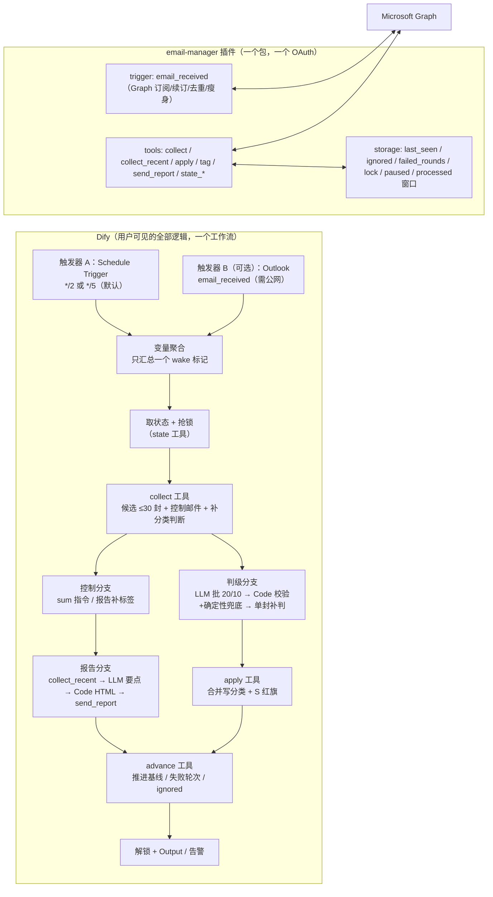

# 方案 A（修订版）：一个插件 + 一个工作流

> 需求：**用户把插件装进 Dify 之后，所有东西都在 Dify 上的一个工作流里跑**（不依赖本地 Python 服务、不再拆成多个 App）。
> 前置阅读：[DIFY_MIGRATION_ADVICE.md](DIFY_MIGRATION_ADVICE.md)、[PLAN_A_DESIGN.md](PLAN_A_DESIGN.md)（插件规格、状态/失败语义、移植清单仍适用；本文替换其中"4 个 App"的编排部分）。
> 对照源码：`Email_manager_beta` v3.0.0；Dify 自部署 1.10–1.19；官方插件 `langgenius/outlook` 1.0.1、`langgenius/outlook_trigger` 1.0.3（均已核对源码）。

---

## 0. 结论

可以做，而且比上一版更接近你要的"下载即用"：

| 交付物 | 内容 | 用户要做的 |
|---|---|---|
| **1 个 Dify 插件** `email-manager` | 合并官方 `outlook`（工具）+ `outlook_trigger`（触发器）+ 新增 `set_categories` / `state_*` / `collect` / `send_report`；**一套 OAuth** | 装插件 → 建 Entra 应用 → 授权一次 |
| **1 个工作流**（DSL） | 监听/唤醒 → 加锁 → 采集 → 分支（sum 指令报告 / 新邮件判级 / 报告补标签 / 补分类 / 失败告警）→ 写回 → 推进状态 → 解锁 | 导入 DSL → 填应用环境变量 → 发布 → 打开 Trigger |
| **1 套分发物料** | 插件 `.difypkg`（GitHub Release / Marketplace / 本地文件）+ 工作流 `.yml` + 安装说明 | 按 README 走一遍 |

**关键判断**：官方 `outlook_trigger` 让"事件驱动"成为可能（新邮件到达即触发，替代 30s 轮询），但它有 4 个必须 fork 修正的问题（见 1.2）；如果不想让用户把 Dify 暴露到公网，就用**同一个工作流的 Schedule Trigger 版本**（1–5 分钟轮询），其余完全一样。

> 单工作流的代价：Trigger 起始的工作流**不能发布为 WebApp/API**，所以原程序的 Categorize/Sum 手动按钮、dry_run 勾选、写前确认框都没有对应 UI。替代方案：手动操作变成"发一封 `sum` 指令邮件"（原程序本来就有），或额外加一个 Webhook Trigger 作为"Run now"入口（需要公网）。

---

## 1. 关键前提：官方 Outlook Trigger 能做到什么

### 1.1 已核对的实现（`triggers/outlook_trigger`，v1.0.3，最低 Dify 1.10.0）

| 能力 | 实现 | 对我们的意义 |
|---|---|---|
| 订阅新邮件 | `POST /v1.0/subscriptions`，`changeType: created,updated`，resource `me/mailfolders('Inbox')/messages`（或共享邮箱），TTL 72 小时 | 真正的"来一封触一发" |
| 续订/退订 | `_refresh_subscription` 用 PATCH 续期；`_delete_subscription` 退订 | Dify 托管，无需外部 cron |
| 事件内容 | 收到通知后**用 Graph GET 拉整封邮件**，作为 workflow 变量（含 `body`、`categories`、`flag.flagStatus`、sender、webLink 等） | 事件里直接有正文和现有标签 |
| 去重 | 插件 storage 记 `email_processed_<id>`，同一封只派发一次 | 防重复触发；但会**无限增长**（见 1.2） |
| 授权 | OAuth（authorization code + refresh，Dify 托管）；默认 scope **`Mail.Read` + `offline_access`** | 只读，**写分类必须改成 `Mail.ReadWrite`** |
| 回调 | 需要 Dify 的 Trigger 回调地址公网可达（Graph 主动 POST），插件处理 validationToken 握手 | 部署门槛：Dify 必须有公网 HTTPS（或 Tunnel） |

### 1.2 为什么必须 fork（5 个修正点）

| # | 问题 | 后果 | fork 修正 |
|---|---|---|---|
| 1 | 订阅 `changeType: created,updated` | 我们写分类会触发 `updated` 通知，形成"自己触发自己"；用户读信也会触发 | 订阅改成 **`changeType: created`**（新建邮件才触发），漏掉的事件交给同工作流的 Schedule 分支补 |
| 2 | 事件 payload 是**整封邮件（含完整 HTML body）** | 大邮件正文可能撞 200KB 变量上限；日志里全是正文 | 事件里只输出瘦身后的字段：`id/subject/from/categories/flag/received/webLink/body_text(截断 ~1500 字)` |
| 3 | `email_processed_<id>` 无上限 | 插件 storage 默认申报 1MB，重度邮箱几个月写满 | 改成环形/时间窗清理（保留最近 7 天或最近 5000 条）；storage 申报 10MB |
| 4 | 默认 scope 只有 `Mail.Read` | 无法写 categories | 统一 OAuth scope：`offline_access User.Read Mail.ReadWrite Mail.Send`，触发器订阅与工具共用同一授权 |
| 5 | 触发器插件与工具插件是**两个包、两次授权** | 用户要装两个插件、授权两次，不符合"一个插件" | 合并进一个插件包（`plugins.tools` + `plugins.triggers` 同时声明；P0 验证打包、若不允许则退回两包） |

> 触发器返回的邮件正文是 HTML 时必须在插件里剥成纯文本并截断（原 `graph._strip_html`，`core/graph.py:436-445`），否则 200KB 变量和 Dify 日志都会被大邮件拖垮。

---

## 2. 总体形态



- **所有判定、分支、报告、告警都在同一个工作流里**；插件只提供"邮件能力 + 状态存储 + 触发器"。
- 工作流**不引用触发器的输出变量**（只用它当唤醒信号），所以 Schedule 版和 Event 版可以共用同一份 DSL：用户把起始节点从 Schedule Trigger 换成 Integration Trigger 即可（Dify 支持右键 Change Node 切换起始节点）。
- 两个触发器版本建议：**默认发 Schedule 版**（零公网要求）；需要实时的用户按 README 切到 Integration Trigger（或我们同时提供双触发器 DSL，见 8.1）。

---

## 3. 插件规格（一个包）

### 3.1 manifest 与权限

```yaml
version: 1.0.0
type: plugin
author: <你的 GitHub handle>        # 从 GitHub 安装时必须与仓库 owner 一致
name: email_manager
label: { en_US: Email Manager, zh_Hans: 邮件管理器 }
resource:
  memory: 268435456
  permission:
    endpoint: { enabled: true }       # 触发器回调需要
    storage: { enabled: true, size: 10485760 }   # 状态 + 去重窗口
plugins:
  tools:
    - provider/email_manager.yaml
  triggers:
    - provider/email_manager_trigger.yaml   # P0 验证同包声明是否通过打包校验
meta:
  version: 0.0.1
  arch: [amd64, arm64]
  runner: { language: python, version: "3.12", entrypoint: main }
  minimum_dify_version: 1.10.0        # 触发器的最低要求
```

### 3.2 授权（一套 OAuth，两种用途）

- `oauth_schema.client_schema`：`tenant_id`（默认 `organizations`）、`client_id`、`client_secret`；
- `oauth_schema.credentials_schema`：`access_tokens`、`refresh_token`（Dify 托管刷新，轮换后的 refresh_token 会存回）；
- scope 统一为：`offline_access User.Read https://graph.microsoft.com/Mail.ReadWrite https://graph.microsoft.com/Mail.Send`；
- Entra 应用：Web 平台，Redirect URI 用 Dify 插件配置页给出的两个回调（工具 provider + trigger subscription_constructor 各一个）；委托权限同上并授予；
- **一个授权同时服务**：订阅创建/续订、读信、写分类、发报告。

### 3.3 工具契约

所有业务失败返回 `{success, transient, error}`，不抛异常（`transient=true` 表示网络/429/5xx，工作流应"不推进状态、下轮重试"）。

| 工具 | 入参 | 出参 | 对应原实现 |
|---|---|---|---|
| `state_get` | — | `{state, version}` | `watcher.load_state`（`watcher.py:49-63`） |
| `state_lock` | `owner`、`ttl_seconds` | `{acquired, holder, lock_until}` | 新增（替代 TaskRunner 串行） |
| `state_unlock` | `owner` | `{released}` | 新增 |
| `collect` | `last_seen`、`days`、`max_items`(≤30)、`catchup`(bool)、`include_controls`(bool) | `{candidates[], controls:{sum_commands[], reports[]}, newest_id, oldest_id, transient, error}` | `graph._collect`（`graph.py:705-736`）+ `_tag_reports`/`_run_commands` 扫描 + `fill_body` |
| `collect_recent` | `days`、`letters` | `{items:[{entryid,level,subject,sender,body,received,web_link}], transient, error}` | `graph.read_recent`（`graph.py:761-781`） |
| `apply` | `verdicts:[{entryid,level,deadline,urgent,is_school}]`、`dry_run` | `{ok, failed, skipped, transient, errors[]}` | `classifier.apply_verdicts` + `mailmeta.merge_categories` + `graph.write_categories` |
| `tag` | `entryids[]`、`names`（如 `["Sum"]`） | `{ok, failed}` | 报告/指令打 `Sum`（`watcher.py:380-430`） |
| `send_report` | `to`、`subject`、`html`、`categories?` | `{success, transient, error}` | `graph.send_mail`（`graph.py:592-600`） |
| `advance` | `oldest_entryid`、`newest_entryid`、`failed`、`ignored_ids[]`、`catchup` | `{last_seen, failed_rounds, gave_up}` | `watcher.advance_policy`（`watcher.py:106-128`） |

- `collect` 内部顺序与 `graph._collect` 一致：只拉头部（`SELECT_HEADERS`，`graph.py:61-63`）→ 跳过自家报告 / `sum` 指令 / 已分类 / ignored / 不新于 `last_seen`（`catchup` 时改为按天全量）→ 对候选逐封取正文（可并发 5–10，截断 400 + 300）→ 返回。
- `apply` 内部：非学校跳过（不写、不算失败）→ `merge_categories` 只替换自己的标签 → S+urgent 打红旗 → 单封失败不拖垮整批。
- `send_report` 也可用于**告警邮件**（失败/暂停通知）。
- 插件是**配置无关**的：`school_domains/courses/faculty/urgent_days` 由工作流环境变量作为参数传入，换学校不用重打包。

### 3.4 触发器（可选组件，同包）

- 事件 `email_received`：订阅 `created`（不是 `created,updated`），resource `me/mailfolders('Inbox')/messages`；
- 收到通知 → GET 邮件 → 去重（带窗口清理）→ 输出瘦身变量；
- 订阅 TTL 72h，由 Dify 调 `_refresh_subscription` 续期；
- 事件变量：`email_id`、`subject`、`sender`、`received`、`categories[]`、`flag_status`、`web_link`、`body_text`（截断）；
- 注意：事件变量**不参与**工作流分支（工作流只当唤醒），避免双触发器版本的变量聚合问题。

---

## 4. 一个工作流的节点设计

### 4.1 结构（单一公共管道，分支只在"处理什么"上）

```text
[Trigger] → [变量聚合: wake] → [state_get] → [Code: 解析状态]
   → If paused → [Output]
   → [state_lock] → If not acquired → [Output skipped]
   → [collect]
   → If controls.sum_commands 非空:
        [tag(commands)] → [collect_recent] → [Code: 分批 20] → [LLM: 要点] → [Code: 宽松回收 + HTML]
        → [send_report] → [tag(report)] → [advance] → [state_unlock] → [Output report]
   → Else If controls.reports 非空:
        [tag(reports)] → [advance] → [state_unlock] → [Output tagged]
   → Else If candidates 为空:
        [state_advance(empty)] → [state_unlock] → [Output idle]
   → Else:
        [Code: 分批 20 + 提示词（规则文本来自 env）]
        → [LLM #1] → [Code: 条数校验 + 确定性兜底]
        → If 第 2 批存在 → [LLM #2] → [Code]
        → If 有失败 → [Iteration: 逐封单判（continue-on-error）]
        → [apply]
        → If transient → [state_unlock] → [Output retry]
        → [advance]
        → If gave_up/失败过多 → [send_report: 告警]
        → [state_unlock] → [Output stats]
   → 任何"真错误"分支: [send_report 告警] → [state_set 错误计数] → [state_unlock] → [Output]
```

节点数约 30–35；单轮步骤 ≈ 60–90（30 封逐封补判时 +30），远低于 `WORKFLOW_MAX_EXECUTION_STEPS=500`。

### 4.2 关键节点配置

| 节点 | 配置要点 |
|---|---|
| 触发器 | 默认 Schedule `*/2 * * * *`（先 5 分钟观察）；可切换为 Integration Trigger `email_received` |
| 变量聚合 | 两个触发器（若同时启用）只收敛一个 `wake=true`，不收敛邮件变量 |
| `state_get` → Code | 若 `paused=true` 直接结束；把 `last_seen/ignored/failed_rounds/last_catchup_date` 解析成变量 |
| `collect` | `catchup = (last_catchup_date != 今天)`；`max_items=30`；`days = catchup ? CATCHUP_DAYS : 7` |
| LLM 判级 | system = 规则文本（Jinja2 + `{{env.*}}`），user = 批内容；temperature 0；结构化输出；`max_tokens` 给足（原 16384）；打开推理标签分离 |
| Code 校验 | 条数必须等于本批；按 `entryid` 对齐（不按顺序 zip）；确定性兜底：课程/学院 → 至少 A，学校域名 → 学校邮件；时区按 UTC+8 算 urgent |
| Code 分批 | 20 + 10；输出字符串（不要 object 数组，Code 默认上限 30 项） |
| Iteration 补判 | 只对失败封逐封调用；`continue-on-error`；上限 30 |
| `apply` | `dry_run` 由环境变量 `DRY_RUN` 控制（默认 false），给用户一个"先只看不写"的机会 |
| `advance` | 全部成功→推进到最旧一封；失败未达 3 轮→不推进；连续 3 轮→放弃并推进（原语义） |
| 告警 | 复用 `send_report` 发给自己；连续错误 3 次 → state_set(`paused=true`)；用户把 `PAUSED` 环境变量或发 `sum` 指令前手动恢复（见 5.3） |

### 4.3 环境变量（用户安装后要填的配置）

| 变量 | 示例 | 用途 |
|---|---|---|
| `EMAIL` / `NAME` / `STUDENT_ID` | `xxx@connect.ust.hk` / … | 判定"点名到我" |
| `SCHOOL` / `SCHOOL_DOMAINS` | `HKUST` / `ust.hk` | 学校邮件确定性判定 |
| `FACULTY` / `FACULTY_KEYWORDS` | `School of Science` / … | 学院邮件至少 A |
| `COURSES` | `COMP 1021, MATH 1014` | 我参与的课程 |
| `DORM_KEYWORDS` | `UG Hall, 宿舍` | 宿舍邮件至少 A |
| `URGENT_DAYS` / `CATCHUP_DAYS` / `SUMMARY_DAYS` / `BATCH_SIZE` | `14 / 7 / 7 / 20` | 原 config 行为 |
| `RECIPIENT` / `LANGUAGE` | 自己邮箱 / `zh` | 报告收件人与语言 |
| `DRY_RUN` | `false` | 只判定不写回 |
| `AI_MODEL` | 选模型的环境变量（LLM 类型 env） | 换模型不改节点 |

---

## 5. 语义保真与单工作流的取舍

### 5.1 保留的 5 条契约（与《建议书》一致）

| 契约 | 单工作流里的落点 |
|---|---|
| C1 条数严格对齐 | Code 节点校验 + 按 `entryid` 对齐；失败→逐封补判（**不再递归对半拆**） |
| C2 只替换自己的标签 | 插件 `apply` 内 `merge_categories`，用户自定义标签保留 |
| C3 基线只在处理完后推进 | 插件 `advance`（失败未达 3 轮不推进） |
| C4 邮箱不可用不算失败 | 工具返回 `transient`，工作流解锁退出，下轮重试 |
| C5 幂等跳过 | 插件 `collect` 用 categories/报告主题/`sum`/ignored 过滤 |

### 5.2 明确的有损点

| 原程序 | 单工作流版 | 影响 |
|---|---|---|
| 递归对半拆 3 层（40→20→10→5） | 批 20 → 失败逐封补判 | 极端坏批次时多花几次单封 LLM 调用；语义仍安全（不猜级别） |
| 30s 轮询 | Schedule 1–5 分钟（或事件驱动） | 实时性略降/或需公网 |
| 手动按钮、dry-run 勾选、写前确认框 | 只有环境变量 `DRY_RUN`、`sum` 指令邮件、可选 Webhook Trigger | 交互能力下降（Trigger 工作流不能发 WebApp/API） |
| Force reset / watchdog | 无；锁 TTL + 运行超时 | 卡住时等 Dify 超时；下一轮自愈 |
| `sum` 指令随时生效 | 下一轮 Schedule（≤1–5 分钟）或事件触发 | 延迟可接受 |

### 5.3 暂停/恢复

Trigger 工作流没有"开关按钮"可言，但可以在 workflow 里实现：
- 连续 3 次真错误 → 插件 `state_set(paused=true)`；
- 每轮开头 `state_get` 检测 `paused` → 直接结束；
- 恢复：用户在 Dify 的 **Access Point → Trigger 卡片**里关掉/打开触发器即可"人工恢复"，或把 `PAUSED` 环境变量改回 false，或发一封主题为 `sum` 的邮件（工作流检测到指令时清 paused）。README 里写清楚。

---

## 6. 分发与安装（"用户下载插件后"的完整路径）

### 6.1 三种分发方式（Dify 官方支持）

| 方式 | 用户操作 | 适合 |
|---|---|---|
| **GitHub 仓库安装** | Plugins → Install → From GitHub → 填仓库 URL | 开源、免审核、可快速迭代（**推荐首发**） |
| 本地 `.difypkg` | Plugins → Install → 本地文件 | 私有/内测 |
| Marketplace | 一键安装 | 面向所有 Dify 用户；需提交审核、隐私政策、签名 |

同时把**工作流 DSL**（`.yml`/`.ifpkg`）和 README 放进同一个 GitHub 仓库：

1. 用户装插件（GitHub URL 或 `.difypkg`）；
2. 用户 Studio → Import DSL → 导入 `email-manager.yml`；
3. 填应用环境变量（第 4.3 节）；
4. 在 Dify 的插件配置页填 Entra 的 Tenant/Client ID/Secret → 保存并授权（一次 OAuth）；
5. 发布工作流 → Access Point 打开 Schedule Trigger（或配置 Integration Trigger）。

### 6.2 用户侧前置条件（README 必须写清）

- **Dify 版本**：Schedule 版 ≥1.7（插件 OAuth）；事件版 ≥1.10；建议 1.11+ / 最新 1.1x；
- **网络**：事件版需要 Dify 有公网 HTTPS（`TRIGGER_URL` 能被 Microsoft Graph 回调；可用 Cloudflare Tunnel/反代）；Schedule 版无需公网；
- **Entra 应用**：Web 平台 + 两个 Redirect URI + 委托权限（`Mail.ReadWrite/Mail.Send/offline_access/User.Read`）+ 客户端密钥；部分学校租户需要管理员同意；
- **插件安装信任**：自部署开签名校验时，GitHub 安装未签名包可能被拒（需签名或按官方 FAQ 关闭校验）；
- **日志保留**：邮件正文会进 Dify 运行日志，提醒用户开日志清理、别把日志外发；
- **常在线**：Dify 停机期间的事件会漏；Schedule 分支的 catchup（最近 7 天未分类）负责补。

### 6.3 版本/升级

- 插件版本与工作流 DSL 版本绑定：README 写明"v1.x 插件配 v1.x DSL"，DSL 里写一个版本校验 Code 节点（插件 `check` 工具返回版本，不匹配就告警）；
- 升级：重新打包 GitHub Release（`version` 递增）→ 用户 Dify 里升级插件 → 重新导入 DSL（Dify 的 import 会替换 draft）。

---

## 7. P0 决策门（半天，必须逐条验证）

| # | 验证 | 通过标准 | 失败时的退路 |
|---|---|---|---|
| 1 | 一个插件包同时声明 `tools` + `triggers`，能 `dify plugin package` 并安装 | 打包/安装成功，两类节点都能用 | 拆成两个包（`email-manager-tools` + `email-manager-trigger`），用户装两个；工作流仍是一个 |
| 2 | fork 后的 trigger 订阅改为 `created` 并成功创建/续订 | Graph 订阅成功、72h 后自动续订 | 保留 `created,updated` + 在事件里过滤"仅当 categories 为空且 received 在 10 分钟内" |
| 3 | 单 OAuth（ReadWrite+Send）同时用于订阅和写回 | 授权后能建订阅 + PATCH 分类 | 回退两套授权（trigger 只读 + tools 读写） |
| 4 | 事件 payload 瘦身后 < 200KB、正文可用 | 大 HTML 邮件也不超限 | 只输出 id，正文由 `collect` 再取 |
| 5 | 双触发器（Integration + Schedule）是否允许汇入同一公共管道 | 同 canvas 可保存/运行；Variable Aggregator 正常 | **单触发器**：默认 Schedule；README 教用户右键 Change Node 切到 Outlook Trigger |
| 6 | 导入 DSL 时插件依赖可识别（`difyctl check console_app dependency`） | 无 leaked dependencies | README 明确"先装插件再导入 DSL" |
| 7 | 运行日志/变量大小/Graph 调用量 | 单轮日志可控、≤ 200KB | 调小 `BATCH_SIZE`/单轮上限 |

---

## 8. 实施计划

| 阶段 | 内容 | 工作量 |
|---|---|---|
| P0 | 上面 7 条验证（装官方两个插件跑通、fork 脚手架、打包、DSL 导入） | 0.5d |
| P1 | fork 合并插件：trigger（created/去重窗口/瘦身/续订）+ tools（state/apply/tag/collect/send/advance） | 2–3d |
| P2 | 一个工作流 DSL：触发器、锁、collect、控制分支、报告分支、判级分支、告警、解锁 | 1.5–2d |
| P3 | Golden Set 对照 + 写回/故障注入验收 | 1d |
| P4 | 打包分发：GitHub Release、README 安装向导、隐私说明、DSL 版本校验 | 0.5–1d |
| 合计 | | **5–7d** |

验收沿用《建议书》8.2：100 封 Golden Set（含 20 封历史难题）、非学校误判为学校 = 0、学校误判为非学校 = 0、S 召回 ≥95%、A/B/C 一致率 ≥90%、deadline 差 ≤1 天（UTC+8）。

---

## 9. 风险清单（单工作流版）

| 风险 | 影响 | 缓解 |
|---|---|---|
| 用户 Dify 无公网 → 事件触发器不可用 | 只能用 Schedule 版 | 默认发 Schedule DSL；事件版作为可选 |
| 一个包不能同时装 tools+triggers | 用户得装两个插件 | 拆两包；或直接用官方两个插件（代价是两套授权） |
| `created,updated` 自触发循环 / 读信触发 | 运行次数暴涨、成本上升 | fork 改 `created`；P0 验证 |
| 事件去重 storage 写满 | 触发器失效 | 窗口清理 + 10MB 配额 |
| 双触发器不能汇流 | 架构退回单触发器 | 默认单 Schedule；事件版单独 DSL |
| Trigger 工作流不能 WebApp/API | 没有手动按钮 | `sum` 指令邮件 + 环境变量 DRY_RUN + 可选 Webhook Trigger |
| 日志含邮件正文 | 隐私 | 自部署 + 日志清理 + README 隐私说明 |
| Entra 学校租户限制同意 | 装不上 | README 写清权限与管理员同意要求 |
| Dify 版本差异（1.10→1.19） | DSL/触发器行为不一致 | 宣告支持版本区间；P0 用目标版本验证 |

---

## 10. 待确认的问题

1. **目标部署**：用户用的是自部署 Dify 还是 Dify Cloud？（决定插件能否本地安装、能否用 GitHub 安装、是否有公网）
2. **能否接受"默认 Schedule 轮询版"**（1–5 分钟，无公网要求）？还是必须新邮件即时触发（要公网 HTTPS + Graph 订阅）？
3. **分发渠道**：GitHub Release（快、免审核）还是先上 Marketplace（审核 + 隐私政策 + 签名）？
4. **插件形态**：一个包（tools+triggers 合并，P0 验证）还是两个包（更稳、用户装两次）？
5. **Dify 最低版本**：设 1.10（触发器）还是 1.11+（更稳）？
6. **手动操作**：接受"发 sum 指令邮件"代替按钮，还是需要额外 Webhook Trigger 做 Run now？
